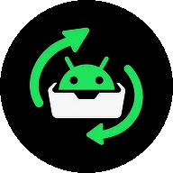
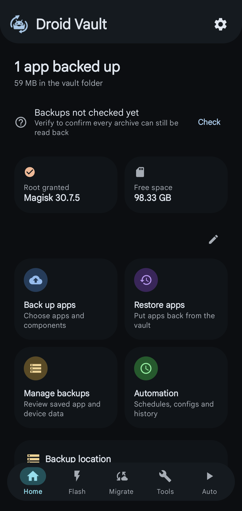
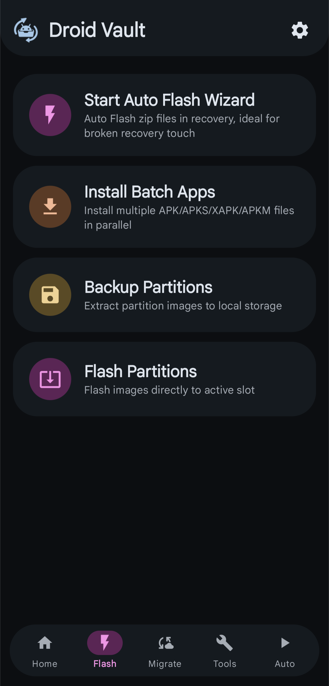
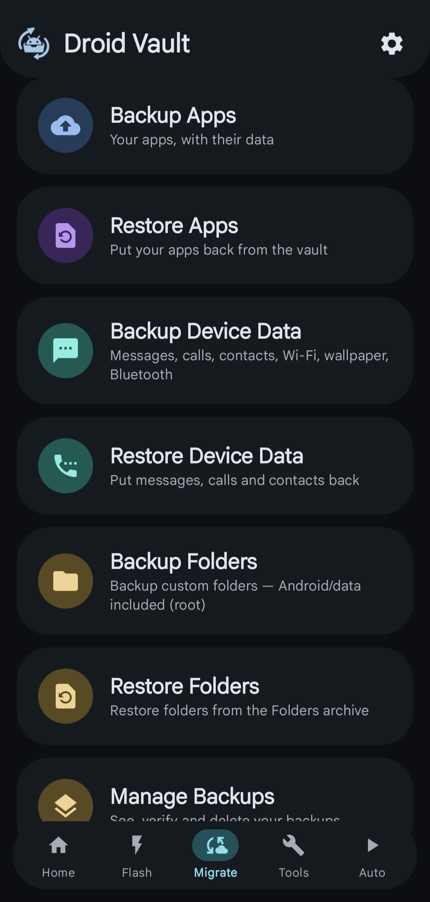
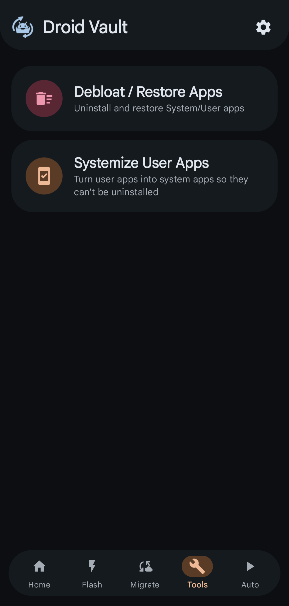
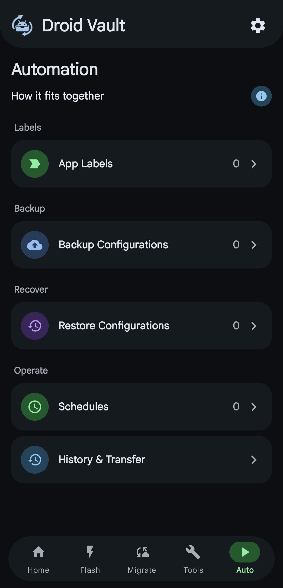
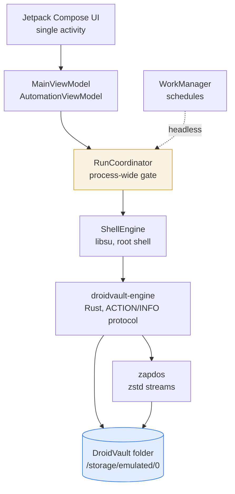

<div align="center">

  

  # ⚡ Droid Vault

  **Backup, restore and migrate a rooted Android phone — entirely offline.**

  <p>
    Apps <em>with their private data</em> · SMS &amp; calls · contacts · Wi-Fi ·
    partitions · scheduled automation
  </p>

  <p>
    <a href="#-screenshots">Screenshots</a> ·
    <a href="#-features">Features</a> ·
    <a href="#-architecture">Architecture</a> ·
    <a href="#-building-from-source">Build it</a> ·
    <a href="#-disclaimer">Disclaimer</a>
  </p>

  <p>
    <a href="https://github.com/phoenix-1708/DroidVault/releases/latest">
      
    </a>
    
    
    
    
  </p>

  <p><b>⚠️ Work in progress.</b> Tested on one device, by one person, on one ROM.</p>
</div>

<br>

Droid Vault backs up what a normal backup app cannot reach: **the private data
inside every app**, the telephony provider's records, and raw partitions. It
does that with a **Rust engine running as root**, a **Kotlin/Compose UI**, and a
single folder on your device that survives a ROM flash.

There is **no cloud account, no telemetry, and no `INTERNET` permission at all.**

---

## 📸 Screenshots

<div align="center">

| Home | Flash | Migrate |
|:---:|:---:|:---:|
|  |  |  |

| Tools | Auto |
|:---:|:---:|
|  |  |

</div>

<br>

---

## 📑 Contents

| | | |
|:--|:--|:--|
| [Overview](#-overview) | [Tech stack](#-tech-stack) | [The vault](#-the-vault) |
| [Screenshots](#-screenshots) | [Architecture](#-architecture) | [Safety](#-safety) |
| [Status](#-status) | [Installation](#-installation) | [Contributing](#-contributing) |
| [Features](#-features) | [Building from source](#-building-from-source) | [Credits](#-credits) · [Disclaimer](#-disclaimer) |

---

## 💡 Overview

Switching ROM usually means reinstalling everything, and most backup tools only
carry over APKs — leaving you to log back into every app and hope your messages
survived. Droid Vault takes the whole device instead.

**What it does differently**

- **Real app data.** Backups are per app *and* per component — the APK, its
  private `data/` directory, granted permissions, `Android/media` and OBB
  expansion files, and the Android ID. Pick exactly what each app contributes.
- **The telephony provider.** SMS/MMS, call logs and contacts are read from and
  written back to the real providers, so messages restore into the messaging app
  you actually use.
- **Single-flight by design.** Manual runs and scheduled runs share one
  process-wide gate, so a nightly job can never collide with what you just
  tapped.
- **Deleting is a rename.** Destructive operations quarantine into `.trash`
  first; only an explicit "erase for good" is irreversible.
- **Survives the flash.** The vault holds a mirror of the app's own APK and
  engine, so a clean-ROM reinstall can restore itself.

Started as a fork of [ROM Shifter](https://github.com/ShivamXD6/ROM-Shifter) by
[ShivamXD6](https://github.com/ShivamXD6), and developed substantially further —
see [Credits](#-credits).

---

## 🚧 Status

<details>
<summary><b>Read this before you trust it with your device</b></summary>

- **No stable release and no release cadence.** Every build is a preview.
- **The backup format may still change.** Keep your own copy of anything you
  care about.
- **Test coverage is one device** — a Xiaomi POCO F6 on HyperOS, `arm64-v8a`.
  `armeabi-v7a` is built and signed but has not been exercised on hardware.
- **Bugs are expected.** Field reports are the most valuable contribution:
  open an issue with what you did, what you expected, and what happened.

</details>

---

## ✨ Features

### ⚡ Flash

| Feature | Notes |
|---|---|
| **Auto Flash Wizard** | Flashes zip files in recovery |
| **Install Batch Apps** | Installs APK / split APK / XAPK / APKM in parallel |
| **Backup Partitions** | Extracts partition images to local storage |
| **Flash Partitions** | Writes images to a slot, from a backup or a custom `.img` |

> Partition writes touch raw hardware. A wrong image hard-bricks a device.

### 🔄 Migrate

| Feature | Notes |
|---|---|
| **Backup / Restore Apps** | Five components per app, selected independently |
| **Backup / Restore Device Data** | SMS & MMS, call logs, contacts, Wi-Fi, wallpaper, Bluetooth |
| **Backup / Restore Folders** | Any folder you nominate, including `Android/data` |
| **Manage Backups** | Verify archives and delete them — into the trash first |
| **Export / Import** | Move the whole vault to another phone as one file |

> App **caches** are not backed up. Apps rebuild their own.

### 🛠 Tools

- **Debloat / Restore Apps** — uninstall system apps, or bring them back
- **Systemize User Apps** — make a user app uninstall-proof, and back

### 🤖 Auto

Scheduled runs that execute **headlessly**, with the app closed.

- Named **configurations**: a selection of apps, device data, and a schedule
- Triggers: **once · daily · weekly · interval**
- **Labels** group apps so one rule covers many
- **Run history** with per-run outcome
- State survives a reinstall — `automation-state.json` lives in the vault and is
  re-imported automatically
- External triggers for Tasker and friends — see
  [`docs/AUTOMATION.md`](docs/AUTOMATION.md)

### ⚙ Settings

- Size **estimate** that reflects what a run will actually rewrite
- Vault health, and archive verification before any restore
- Consent gates and diagnostics

---

## 🧰 Tech stack

| Layer | Technology |
|---|---|
| **UI** | Jetpack Compose (BOM `2026.08.00`), Material 3, single activity |
| **Language** | Kotlin `2.4.10` · Rust `edition 2024`, `panic = "abort"` |
| **Build** | Gradle `9.7.0`, AGP `9.3.2`, JDK 17 bytecode on JDK 21+ |
| **SDK** | `compileSdk`/`targetSdk` **37**, `minSdk` **29** (Android 10) |
| **Root** | [libsu](https://github.com/topjohnwu/libsu) `6.0.0` |
| **Scheduling** | WorkManager `2.10.0` |
| **Compression** | `zapdos` — a zstd fork; see [Credits](#-credits) |
| **Native targets** | Engine cross-compiled for `arm64-v8a`, `armeabi-v7a`, `x86_64`; release APKs are split and ship `arm64-v8a` and `armeabi-v7a` |

Roughly **40k lines of Kotlin**, **4.5k of Rust**, and **572 tests**
(529 Kotlin + 43 Rust) run on every release.

---

## ⚙ Architecture



**How a run reaches the engine**

The engine writes a line-based protocol — `ACTION:PART`, `ACTION:GLOBAL_DONE`,
`ACTION:ERROR`, `ACTION:CANCELLED` — which the app parses into typed events and
turns into progress. Every run holds `RunCoordinator` for its whole duration, so
a second run is refused with a clear message rather than corrupting the first.

Every long operation watches **byte progress**, not elapsed time. A timeout that
cannot tell "hung" from "slow" does not get to kill a slow run — which is why a
30 GB backup is not subject to a flat time limit.

---

## 📋 Requirements

| | |
|---|---|
| **Root** | **Required** — Magisk, KernelSU or APatch, and forks |
| **Android** | 10 (API 29) or newer |
| **Storage** | Room for the backup, plus one working copy during export |
| **Network** | **None.** The app declares no `INTERNET` permission |

> Root is not optional. Reading another app's private data is impossible without
> it. Only install this on a device you own, and only with backups you can lose.

---

## 📥 Installation

1. **Download** from the [releases page](https://github.com/phoenix-1708/DroidVault/releases/latest)
   and pick your architecture:

   | File | Device |
   |---|---|
   | `arm64-v8a-release.apk` | Most modern phones (2017 onward) |
   | `armeabi-v7a-release.apk` | Older 32-bit devices |

   There is no Play Store listing.

2. **Install it**, open the app, and grant root when prompted.

3. **Choose a vault folder** in the setup wizard. The default is
   `/storage/emulated/0/DroidVault`.

> Installing over a build signed with a *different* key requires an uninstall
> first, which deletes app preferences. The vault lives outside app data and is
> untouched — but Magisk's per-UID grant is dropped, so redo the root grant and
> onboarding afterwards.

---

## 🛠 Building from source

You need **JDK 21+** to run Gradle, the **Android SDK (API 37)**, and — for the
native engine only — **Rust** and the **Android NDK**.

```sh
git clone https://github.com/phoenix-1708/DroidVault.git
cd DroidVault
```

**1 · Point Gradle at your SDK.** Create `local.properties` (gitignored, never
commit it):

```properties
sdk.dir=/path/to/Android/sdk
```

**2 · Provide the NDK.** The Rust engine is cross-compiled for three ABIs. The
build looks, in order, at:

1. `-Pdroidvault.ndkPath=…`, or `droidvault.ndkPath=` in `gradle.properties`
2. `ANDROID_NDK_HOME` / `ANDROID_NDK_ROOT`
3. `ndk.dir=` in `local.properties`
4. the newest versioned NDK under your SDK root

If it finds none, it says so in words rather than failing on a missing `clang`.

```sh
export ANDROID_NDK_HOME=/path/to/android-ndk
```

> Only the native engine needs the NDK. **The entire Kotlin test suite runs
> without one** — useful for quick contribution checks.

**3 · Build and test.**

```sh
sh gradlew testDebugUnitTest      # Kotlin unit tests
sh gradlew assembleDebug          # debug APK
sh gradlew assembleRelease        # release APKs, one per ABI (R8 + shrinking)

cd engine
cargo test
cargo fmt --check
cd ..
```

Use `sh gradlew`, not `./gradlew` — the wrapper is not marked executable in the
repository.

| Artifact | Path |
|---|---|
| Debug APK | `app/build/outputs/apk/debug/app-debug.apk` |
| Release APKs | `app/build/outputs/apk/release/app-<abi>-release.apk` |

<details>
<summary><b>Signing a release locally</b></summary>

Release signing reads `keystore.properties` at the repository root, falling back
to environment variables. **Neither is committed, and both are gitignored.**

```properties
storeFile=keystore/droidvault-release.jks
storePassword=...
keyAlias=...
keyPassword=...
```

The CI equivalents are `KEYSTORE_FILE`, `KEYSTORE_PASSWORD`, `KEYSTORE_ALIAS`
and `KEY_PASSWORD`. If no key is found, the release build falls back to the
**debug key** and prints a loud warning — such a build **cannot** update a
release-signed install and must not be distributed.

</details>

<details>
<summary><b>Publishing a release</b></summary>

Push a `v*` tag and the [release workflow](.github/workflows/release.yml) builds,
signs, verifies and publishes both APKs:

```sh
git tag v1.1.0
git push origin v1.1.0
```

Before the first run, add the signing secrets to the repository. One-time setup
is documented in [`docs/SETUP.md`](docs/SETUP.md).

> `versionCode` must keep rising — Android refuses to install over a higher one.

</details>

---

## 🗄 The vault

One folder holds everything. **This is what you preserve across a ROM flash.**

```text
/storage/emulated/0/DroidVault/
├── Apps/User/<label>/        per-app archives (.shift files)
├── Apps/System/<label>/
├── Device/
│   ├── Messages.shift         SMS & MMS
│   ├── CallLogs.shift         call history
│   ├── Contacts.shift         contacts (.vcf)
│   ├── Wi-Fi.shift            saved networks
│   ├── Wallpaper.shift
│   ├── Bluetooth.shift
│   └── Folders.shift          custom folders, manifest inside
├── DroidVault.apk             this app's own APK — reinstall kit
├── DroidVault.engine          engine + launcher mirrors
├── automation-state.json      durable automation state (chmod 600)
└── .trash/                    quarantine for deleted backups, kept 7 days
```

Every `.shift` file is a **zstd stream**. The engine records each component's
size in `Meta.txt` and skips a part whose recorded size still matches the live
one — so a repeat backup writes only what actually changed.

---

## 🛡 Safety

The rules the codebase is built around. Where a test can enforce one, it does.

| | |
|---|---|
| **Deleting is a rename** | Destructive actions move archives to `.trash`. Erasing for good is a separate, explicit step. |
| **Never truncate the last good copy** | Every writer streams to a temp path and renames over the destination. |
| **Verdicts describe the work** | A run reports complete only from the engine's own per-part outcome — never from the plan. |
| **Verify before restore** | A damaged archive blocks the restore, and that result survives the dialog being closed. |
| **Absence is not failure** | "No matching rule" is a skip, not an error. |
| **No internet, ever** | There is no `INTERNET` permission; adding one would be a deliberate breaking change. |

---

## 🤝 Contributing

Issues and pull requests are welcome — **field reports especially**, since this
is tested on a single device.

Before opening a pull request:

```sh
sh gradlew testDebugUnitTest
cd engine && cargo fmt --check && cargo test && cd ..
```

A few conventions the codebase holds to:

- **Comments explain *why***, and cite the failure that motivated them.
- **No `TODO` / `FIXME` markers** — a decision belongs in the code, explained.
- **Destructive paths must be recoverable** — quarantine first, or make the
  irreversible step explicit.
- **Shell interpolation goes through `ShellQuote`**; no raw string building.

There is no `CONTRIBUTING.md` yet — this section is the short version.

---

## 📄 Credits

**Droid Vault is based on
[ROM Shifter](https://github.com/ShivamXD6/ROM-Shifter) by
[ShivamXD6](https://github.com/ShivamXD6) and the
[Build Bytes](https://telegram.me/buildbytes) team, licensed GPL-3.0.**

Full attribution — including the bundled `zapdos` binary and the zstd library
inside it — is in [`CREDITS.md`](CREDITS.md).

| Component | Origin | Licence |
|---|---|---|
| `libzapdos.so` | zstd fork by ShivamXD6, inherited from ROM Shifter | GPL-3.0 |
| zstd (inside it) | Yann Collet & contributors | BSD-3-Clause OR GPL-2.0 |

## 📚 Further reading

| Document | What it covers |
|---|---|
| [`docs/AUTOMATION.md`](docs/AUTOMATION.md) | Headless triggers and external automation |
| [`docs/SETUP.md`](docs/SETUP.md) | Release secrets, tagging, publishing |
| [`docs/STABILITY.md`](docs/STABILITY.md) | Crash handling and failure modes |
| [`CREDITS.md`](CREDITS.md) | Attribution chain |

---

## ⚠ Disclaimer

**This project is vibe coded.** It was built iteratively with AI assistance, and
that has consequences worth weighing before trusting it with your data.

- It has **not** been reviewed by a professional cryptographer, security auditor
  or Android engineer.
- It is tested on **one device, by one person, on one ROM**.
- **It is not audited, certified or production-ready.** Treat it as a preview.
- It performs privileged, destructive-capable operations **as root**. Root
  access is the premise; bugs here have real consequences.
- **Keep an independent backup.** Do not make Droid Vault your only copy of
  anything.
- Provided **"as is", without warranty of any kind**, to the maximum extent
  permitted by law. The authors are not liable for damage arising from its use.

**You are responsible for what you do with your device.** Flash at your own
risk, back up first, and read what you are signing.

---

<div align="center">

**[⬆ Back to top](#-droid-vault)**

Developed by [**phoenix-1708**](https://github.com/phoenix-1708) ·
Based on ROM Shifter by [ShivamXD6](https://github.com/ShivamXD6) ·
[GPL-3.0](LICENSE)

</div>